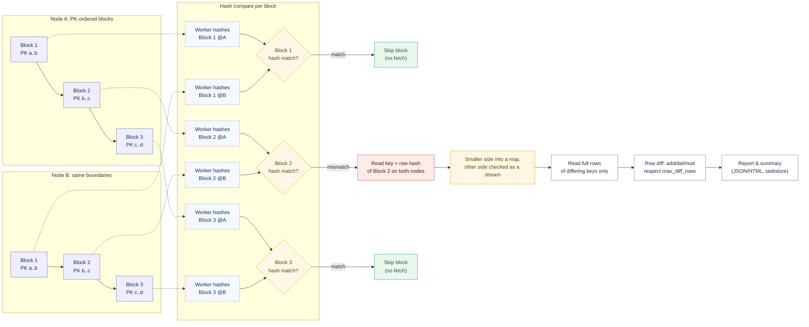
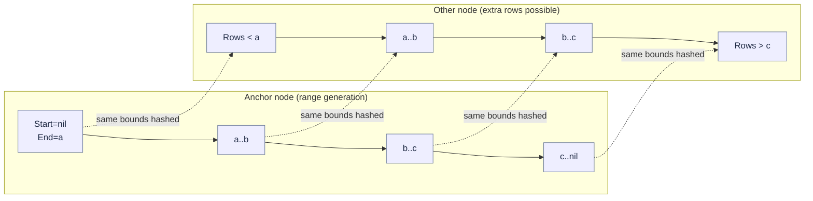
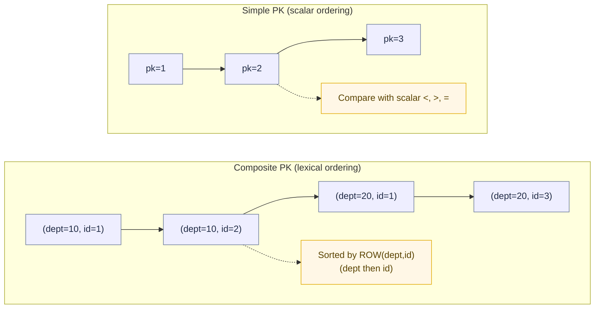

# Table Diff Architecture

The design of table diff is driven by the following requirements and constraints:

- Whether a table is kept consistent via logical replication, physical replication, backup/restore, or bulk copy, operators need a fast, low-impact way to verify that the replicas really match.
- Full-table comparisons that take hours are operationally risky (locks, lag, disk and network blow-ups). We need a method that scales down to quick “am I in sync?” checks and scales up to multi-billion-row tables without bringing the cluster to its knees.
- The outcome should be actionable: pinpoint what differs (adds/deletes/changes) rather than a binary “good/bad,” so remediation can be targeted.

## Existing Approaches and Their Limitations

- **Dump + file diff (e.g., `pg_dump` then `diff`)**
  - Pros: simple tooling, easy to script.
  - Limitations: requires extracting the entire table; dumps must be sorted or canonicalised to be diffable; produces huge intermediates; easily runs for hours on large tables; false positives from ordering/format differences.
- **Whole-table checksum**
  - Pros: single pass, compact result.
  - Limitations: still scans the whole table; a single checksum gives no locality of differences; any drift forces another full scan to localise; sensitive to scan order; changes during the scan can invalidate results.
- **Row-by-row comparison script**
  - Pros: can respect primary-key ordering and return precise differences.
  - Limitations: typically single-threaded and network-heavy; must stream or materialise the entire table; slow on wide rows; prone to timeouts and snapshot drift if not carefully managed; bespoke scripts vary in correctness and performance.

## Algorithm (Block-Hash Diff)

The table is partitioned into primary-key ranges (blocks). Identical block boundaries are applied on every node. Each range/node pair is hashed by parallel workers; only for the blocks whose hashes disagree does ACE look for the differing rows, through a map of keys and row hashes (see [Finding the Differing Rows](#finding-the-differing-rows)).



### Block Boundaries

ACE takes the block boundaries from one anchor node: the node with the
highest estimated row count. The estimate is used only to choose this node;
the number and the size of blocks do not depend on it. The code is in
`internal/consistency/slicer`; `mtree build` uses the same code.

1. **Parts.** ACE splits the key space of the anchor node into K parts, the
   units of work for the cutting workers. Of the N connections to the
   anchor node, one in five goes to a cutting worker (at least one, at most
   four), and there are four parts per cutting worker, so K does not depend
   on the size of the table. The part bounds come from
   `pg_stats.histogram_bounds` of the first primary-key column: each chosen
   value becomes the first key of the anchor node that is not less than it.
   If the column has no histogram (the table was never analyzed, or the
   first column of a composite key has few distinct values), the bounds
   come from a `TABLESAMPLE SYSTEM ... REPEATABLE` sample of the key, split
   with `ntile(K)`. The sample reads about 100 pages per part, at least
   1000; a smaller table is read in full. ACE does not check how old the
   histogram is: an old histogram makes some parts larger (on an
   append-only table, the last one), but the blocks stay the same.
2. **Blocks.** A cutting worker walks its part in key order on the anchor
   node and starts a new block every `block_size` rows. One query cuts a
   chunk of blocks by jumping `block_size` rows forward from the current
   block start:

   ```sql
   WITH RECURSIVE b(i, <key>) AS (
       (SELECT 0, <key> FROM t
        WHERE <key> >= <block start> AND <key> < <hi> AND <filter>
        ORDER BY <key> LIMIT 1)
     UNION ALL
       SELECT b.i + 1, x.*
       FROM b CROSS JOIN LATERAL (
           SELECT <key> FROM t
           WHERE <key> >= b.<key> AND <key> < <hi> AND <filter>
           ORDER BY <key> OFFSET <block_size> LIMIT 1) x
       WHERE b.i < <blocks in chunk>
   )
   SELECT i, <key> FROM b ORDER BY i
   ```

   Each jump is one descent of the primary-key index that reads
   `block_size` entries, and only one key per block goes back to ACE. When
   a jump finds no row, the part ends, and ACE counts the rows of its last
   block. So, when a block is cut, it holds at most `block_size` rows on the
   anchor node, whatever the key distribution, the physical row order or
   the size of the table. Rows that `table_filter` removes are not counted.
   The limit is not a promise about other nodes or later moments: the first
   and the last block are open (see below), and rows written during the run
   can make any block larger.

   Every cutting worker has its own connection and cuts all its parts in
   one read-only `REPEATABLE READ` transaction, with `enable_seqscan` and
   `enable_sort` off; otherwise, with a selective filter, the planner can
   choose a sequential scan and a sort for every jump. The first chunk of a
   part cuts one block; each next chunk cuts twice as many, up to about one
   million rows, so the first block is ready at once. While a worker runs,
   the anchor node cannot vacuum rows that became dead after its
   transaction started; the cut never waits for the hash workers, so this
   lasts one pass over the key index. The workers do not need one common
   snapshot: a block is a key range, and every node hashes the same ranges.
   How the hashes see concurrent writes does not change: each block hash is
   its own query on each node. On a laptop one cutting worker cuts 5–6
   million `bigint` keys per second, and the rate grows linearly with the
   number of workers.

Workers add each block to one shared list as soon as they cut it, so
hashing does not wait for a full pass over the key. Every node has its own
hash workers, each on its own connection, and its own position in the
list: a slow node is behind, a fast node is ahead, and neither waits for the
other. When a cutting worker ends, its connection becomes one more hash
worker on the anchor node. Blocks of different parts can arrive in any
order; the comparison step sorts them by key.

#### Blocks from a sample

The cutter has one weak point: the visibility map. On a heap page that is
not all-visible, the Index Only Scan reads the heap for every index entry.
With a key that does not follow the heap order (a UUID or a hash), this is
one random page read per row, and it costs about as much as the hash of
the row. So on a large table in active use, the cut can take longer than
the hashing, and the anchor node becomes slower than the other nodes.

`table_diff.slicer` (`--slicer`) chooses how to cut:

- `cutter`: the index walk above.
- `sample`: one query on the anchor node reads a `TABLESAMPLE SYSTEM (p)
  REPEATABLE (seed)` sample of the key, sorts it on the server and returns
  every 10th key:

  ```sql
  SELECT rn, n, same, <key> FROM (
      SELECT <key>, rn, count(*) OVER () AS n,
             coalesce(sum(s) OVER (), 0) AS same
      FROM (
          SELECT <key>, row_number() OVER w AS rn,
                 (lag(blk) OVER w = blk)::int AS s
          FROM (SELECT <key>, (ctid::text::point)[0] AS blk
                FROM t TABLESAMPLE SYSTEM (p) REPEATABLE (1)) t
          WINDOW w AS (ORDER BY <key>)
      ) u
  ) s
  WHERE rn % 10 = 0 OR rn = n
  ORDER BY rn
  ```

  These keys are the block bounds, with open edge blocks as for the
  cutter. `p = min(100, 100 * 10 / block_size)` percent, so a block holds
  about 10 sampled keys and about `block_size` rows on average, for any
  table size (1% of the pages for a block size of 1000; the whole table
  for a block size of 10 or less). The cost does not depend on
  the visibility map. The blocks are not exact: on a heap that is not in
  key order a block can be a few times larger than `block_size`. On a heap
  in key order, every sampled page gives a run of neighbour keys, and the
  blocks become very uneven, so the sample is not used there. The query
  ends before hashing starts, so it does not hold a snapshot during the
  run. It is one operation on the anchor node, so the block timeout limits
  it: with a small block size the sample can read the whole table.

  The query also counts `same`, the sampled keys that lie on the same heap
  page as the key before them in key order. On a heap that is not in key
  order this share is close to 0 (about one in the number of sampled
  pages); when rows with near keys share pages it is close to 1. The
  catalog cannot show the second case when the correlation is low: for
  example, many loaders that write separate key ranges at the same time
  give a low correlation, but the rows of a block lie on a few pages. If
  the share is above 50%, `auto` takes the cutter instead; no block has
  been hashed yet, so this costs only the sample query. An explicit
  `--slicer=sample` is kept, and the log warns that the blocks will be
  very uneven.

  If the sample query fails, for example on a table whose access method
  has no `TABLESAMPLE` or when it hits the block timeout, `auto` takes the
  cutter. An explicit `--slicer=sample` fails with the error. If the
  sample has fewer than 100 keys, the catalog overstated the number of
  rows or the sample missed most of them. Its bounds are few, and one
  block could hold most of the table, so `auto` takes the cutter here
  too; an explicit `--slicer=sample` keeps the sample.
- `auto` (the default) reads two values from the catalog of the anchor
  node: `rho`, the largest absolute `pg_stats.correlation` over the primary
  key columns, and `u`, the share of pages that are not all-visible:
  `max(1 - relallvisible / relpages, min(1, 2 * n_mod_since_analyze /
  relpages))`. `relallvisible` is exact only right after VACUUM or
  ANALYZE, and each changed row can clear the bit of two pages, so the
  second term covers the changes since then. ACE takes the cutter if a
  row filter is set (`--table-filter`, `--against-origin` or `--until`),
  if the table is partitioned or has child tables, if the table has fewer
  than 100 blocks of rows, if a key column has no statistics or the number
  of rows is not known (and advises ANALYZE), if `u <= 5%` or if
  `rho >= 0.1`. Otherwise it takes the sample. When the cutter runs with
  `u > 35%`, the log warns that the anchor node will be slower than the
  other nodes and advises VACUUM.

How much the sample saves depends on how many cutting workers the anchor
node has against its hash workers. Every node has its own hash workers,
one per connection, and on the anchor at least one connection in five
goes to a cutting worker: with 8 connections, 2 cutting workers and 6 hash
workers. A heap read of the cutter costs about as much as the hash of a
row, so the cut takes about `3 * u` of the hashing time of the anchor, and
it is on the critical path when more than about a third of the pages are
not all-visible. With the sample, all connections of the anchor hash from
the start. The threshold of 5% for `u` stays low on purpose: on a heap
that is not in key order the sample costs only one query on a small share
of the pages, so taking it too early loses little.

The way to cut never changes the result: blocks are key ranges, and every
node hashes the same ranges. Only the time can change. ACE does not switch
the way to cut during a run, because all nodes share one set of blocks. If
a run that was cut by a sample hits the block time limit, it stops with an
error that names the way to cut, `rho` and `u`, and advises to run again
with `--slicer=cutter`. If the cutter runs for at least 10 s and the hash
workers of every node wait for blocks more than half of that time, the log
says that the cut was slower than the hashing. The log, the diff file and
the task store show the way to cut and the values it was chosen from
(`slicer` in the summary). `TotalRowsChecked` is the sum of the row counts
that the hash queries of the anchor node return, for both ways to cut.

The log shows how ACE built the boundaries: the part source and why, the
anchor node, the number of parts and workers, and, at the end, the number
of blocks, the largest block, the time to the first block and the time to
cut all blocks.

### Range Alignment Across Nodes

Challenge: block boundaries come from the anchor node. Other nodes may have
rows that sort before the anchor’s first PK or after its last PK. If we only
used closed intervals from the anchor, those edge rows would never be
hashed.

- The first block has no lower bound: it is `(NULL, k_first)`, where
  `k_first` is the first key of the anchor node. On the anchor node it is
  empty.
- The last block has no upper bound: it is `[k_last, NULL)`. On the anchor
  node it holds at most `block_size` rows.
- Each block is applied identically to every node. In `hashRange`, `nil`
  means “no bound,” so rows of another node outside the anchor’s key range
  fall into the first or the last block and surface as hash mismatches.
  On such a node these two blocks can hold more than `block_size` rows:
  the extra rows are differences, and the key map finds them.



### Finding the Differing Rows

When the hashes of a block differ on two nodes, ACE finds the rows that differ in one pass over the block on each node. The code is in `internal/consistency/keydiff`; `mtree table-diff` uses the same code.

1. **Key query.** On both nodes ACE runs the same query over the block (the same key range and filter as the block hash). For every row it returns the text of each primary-key column and the first 8 bytes of the row hash, the same row hash that the block hash is built from. Row hashes are only compared for the same key, so 8 bytes are enough: a changed row is missed with a probability of 2^-64. A `numeric` key column goes through `trim_scale()`, so `1.50` and `1.5` are the same key. The query has no `ORDER BY`.
2. **Build.** The block hash query also counts the rows of the block. The node with fewer rows is the build side: ACE puts its keys and row hashes into a map. If the build side has no rows, this step is skipped.
3. **Probe.** ACE reads the key query of the other node as a stream. A row whose key is not in the map, or whose row hash is different, is a difference. A row with the same key and the same hash is removed from the map, so the map gets smaller during the probe. The keys left in the map at the end exist only on the build side.
4. **Row read.** ACE reads the full rows of the differing keys from both nodes, 2000 keys per query. The key texts go to the server as `text[]` parameters and are cast back to the column type. Each key is looked up in a `LATERAL` subquery with `OFFSET 0`, so the plan is a nested loop with one lookup in the primary-key index per key, never a scan of the whole table. The exception is a table with inheritance children: the index of the parent does not cover them, so for such a table ACE leaves the choice to the planner, which can read each child once for all keys of the batch instead of once per key. The final result uses only the row hashes from the server: a key with rows on both nodes and different hashes is a changed row, a key with a row on one node only is a missing row, and a key whose rows are equal again (they changed during the run) is not reported.

The client compares bytes for equality only. It never orders key values and never converts them to Go types. Two keys that the server holds as equal but prints in a different way (`-0` and `0` in a `float` column, `citext` values that differ only in case, values under a nondeterministic collation) are two different rows for ACE: such a row is reported as missing on each node. Logical replication copies values as they are, so these cases are not expected between replicas.

In an inheritance tree the parent and a child can hold rows with the same key. The map and the row read treat the rows of a key as a multiset, so each such row is compared.

**Memory.** The keys of one block are limited by `table_diff.key_map_max_memory_mb`, 512 MB by default; 0 means no limit. Before the build, ACE estimates the memory from the row count and the average key width in `pg_stats`; during the build and the probe it counts the bytes of the keys it holds. When a block needs more, the run stops with an error that names the table, the block, the nodes, the row counts and the setting. Several blocks are compared at the same time, so the total memory can be the number of workers times the limit. With the default block sizes and keys of a normal size the limit is not reached.

**Connections and time limit.** The queries of one comparison run one after another, so a comparison uses at most one connection at a time. Each of them is one operation on the block: `block_timeout` limits it, and the wait for a free connection does not count.

**Result on disk.** The full rows of the differing keys are read in batches, and each batch goes to the file of its block in the result directory as soon as it is read. So the client holds the key map of a block and one batch of rows for each worker, however many rows differ. The rows of a block are in the order of the key list, not sorted; only the HTML report sorts the rows it shows.

**Limit.** `max_diff_rows` counts the differing rows of all node pairs of a run. A block is compared completely or not at all. After a block, its rows are added to the count; when the count reaches the limit, the blocks that are not compared yet are skipped. The limit is approximate: the blocks in work at that moment are compared to the end.

### Comparison Notes: Simple vs Composite Primary Keys

- **Ordering and hashing**
  - Simple PK: ranges use scalar bounds; hashing binds one value for lower/upper when present.
  - Composite PK: ranges are tuples (`ROW(col1, col2, ...)`); hashing binds each component, and comparisons rely on the tuple sort order.
- **Row search**
  - Simple and composite PKs work the same way: the key ID of a row is built from the text of every key column, and the row read binds one `text[]` parameter per key column.
  - Arrays/UDTs get cast to `TEXT` to avoid OID/scan issues regardless of PK shape.
- **What users should watch for**
  - Ensure the declared PK is the true business key; otherwise, composite drift can hide behind non-unique or misordered keys.
  - If the first key column has few distinct values, ACE cannot use its histogram and takes the part bounds from a sample. This is a little slower to start, but the blocks keep their size.
  - Avoid nullable or unstable key components (e.g., keys derived from timestamps that can change) to keep comparisons consistent over time.



### Resource Utilisation and Tuning

- **block_size**: Larger blocks reduce hash tasks but increase memory/IO per hash and the size of the key map of a mismatched block; smaller blocks do the opposite (more queries, finer locality).
- **concurrency_factor**: CPU ratio (0.0–4.0) relative to `NumCPU` (e.g. 0.5 on a 16-CPU host gives 8) for the comparison phase only: it runs this many tasks at the same time. Higher = faster localisation of differences but more load on DB backends, network, and local CPU. It does not change the speed of hashing, which depends on `max_connections`. Without a `max_connections` value set by the user, the connection pool per node has room for all comparison tasks (minimum 4).
- **max_connections**: The number of connections N that the task opens to each node at the start and keeps until the end. Cutting and hashing use exactly these connections: every hash worker and every cutting worker holds its own one, so no worker waits for the pool. A server with fewer free slots gives fewer connections, and the task goes on with them. If the user sets N (on the command line or in the configuration file), it is a strict limit for the whole task: the pool of a node holds exactly N connections, and the comparison phase runs at most N tasks at the same time, so it never waits for a connection. Without such a value the pool holds at least N connections and at least the number that the comparison phase needs.
- **key_map_max_memory_mb**: Memory limit for the keys of one mismatched block. Raise it only for very large blocks or very long keys.
- **compare_unit_size**: No longer used. ACE accepts it and writes a warning.
- **max_diff_rows**: Early-exit guardrail for all node pairs of a run, approximate. Lower caps keep runs short and results small on divergent tables; raising/removing can grow the result on disk and the run time when drift is large. It does not change the memory of the client.
- **table_filter**: Narrows scope and cost; rows that do not match the filter do not count toward `block_size`. Must be identical across nodes to avoid false positives.
- **override_block_size**: Skips safety rails from `ace.yaml`. Oversized blocks can spike memory and slow hashes, especially on wide rows.
- **output (json/html)**: HTML adds minor post-processing; DB load is unaffected.

### Failure Modes and Safeguards

- **Diff limit hit**: `max_diff_rows` skips the blocks that are not compared yet and marks the report; more differences may exist.
- **Key map too large**: a mismatched block that needs more memory than `key_map_max_memory_mb` stops the run with an error.
- **Permission or schema/PK mismatch**: Validation fails before work starts; nothing is executed against the DB.
- **Timeouts/slow ranges**: `block_timeout` limits each query on a block (a hash, or a key query or a row read of a block that differs), and `run_timeout` limits the whole run. The first error, a time limit or a signal stops the workers on all nodes, and the run reports that cause.
- **Stale stats**: Some parts are larger, so the cutting work is less even. Block size does not depend on statistics.

### Consistency Caveats
- No cross-node snapshot coordination. Concurrent writes during a run can appear as drift.
- Prefer quiescent windows or use `table_filter` to target stable partitions.
- PK stability matters: changing PK values mid-run can reshuffle ordering and produce noisy diffs.

### Operational Tuning Playbook

- Start conservative on busy systems: smaller `max_connections` and `concurrency_factor`, moderate `block_size`.
- For large but mostly consistent tables: increase `block_size` and `max_connections` to hash faster.
- For drift-heavy tables: lower `block_size` to keep the key map of each block small; keep `max_diff_rows` low to bound runtime and report size.

### Limits and Edge Cases

- Requires a declared PK; up to three-way diffs only.
- `table_filter` creates per-node materialized views; filters must match exactly across nodes.
- Parts from an old histogram or a sample can be uneven. This changes only how the cutting work is shared between workers, not the block size.
- Wide JSON/bytea/UDT columns increase hash and fetch cost.

### Observability

- Logs show range hashing progress, mismatches, the result of the row search of each mismatched block (at debug level), and diff limits.
- Progress bars (mpb) reflect hash and mismatch-analysis stages.
- Task status and summary are persisted to SQLite (`ace_tasks.db` by default, or the `ACE_TASKS_DB` path) via `taskstore` in table `ace_tasks` with columns: `task_id`, `task_type`, `task_status`, `cluster_name`, `task_context` (JSON), `schema`, `table_name`, `repset_name`, `diff_file_path`, `started_at`, `finished_at`, `time_taken`. Example rows:

  | task_id       | task_status | cluster | schema | table_name       | diff_file_path                                      | started_at           | finished_at          | time_taken | task_context (truncated)                                                                                  |
  |---------------|-------------|---------|--------|------------------|------------------------------------------------------|----------------------|----------------------|------------|-----------------------------------------------------------------------------------------------------------|
  | 9f7f…e21b     | COMPLETED   | acctg   | public | customers_large  | public_customers_large_diffs-20250722120353.json    | 2025-07-22T12:03:51Z | 2025-07-22T12:03:53Z | 2.1        | {"qualified_table":"public.customers_large","mode":"diff","nodes":"all","diff_summary":{...}}            |
  | 3b2c…9aa4     | FAILED      | acctg   | public | orders           |                                                      | 2025-07-21T10:15:00Z | 2025-07-21T10:15:08Z | 8.0        | {"qualified_table":"public.orders","mode":"diff","nodes":"n1,n2","error":"user \"replicator\" lacks…"}   |
  | 1a4d…c7f2     | COMPLETED   | acctg   | public | invoices         | public_invoices_diffs-20250720115900.json           | 2025-07-20T11:58:55Z | 2025-07-20T11:59:00Z | 5.0        | {"qualified_table":"public.invoices","mode":"diff","nodes":"n1,n2","table_filter":"billing_cycle = …"}   |

- Diff reports write to timestamped JSON (and HTML if selected); paths are logged on completion.
- Sample analytics (SQLite):

  - Recent table-diff runs:
    ```sql
    SELECT task_id, task_status, started_at, finished_at, time_taken, diff_file_path
    FROM ace_tasks
    WHERE task_type = 'TABLE_DIFF'
    ORDER BY started_at DESC
    LIMIT 20;
    ```

  - Success/fail counts over the last 7 days:
    ```sql
    SELECT task_status, COUNT(*)
    FROM ace_tasks
    WHERE task_type = 'TABLE_DIFF'
      AND started_at >= datetime('now','-7 day')
    GROUP BY task_status;
    ```

  - Drift summary by run (JSON fields from `task_context.diff_summary`):
    ```sql
    SELECT
      task_id,
      json_extract(task_context, '$.diff_summary.total_rows_checked')   AS rows_checked,
      json_extract(task_context, '$.diff_summary.mismatched_ranges_count') AS mismatched_ranges,
      json_extract(task_context, '$.diff_summary.diff_row_limit_reached')  AS limit_hit
    FROM ace_tasks
    WHERE task_type = 'TABLE_DIFF'
    ORDER BY started_at DESC
    LIMIT 20;
    ```
